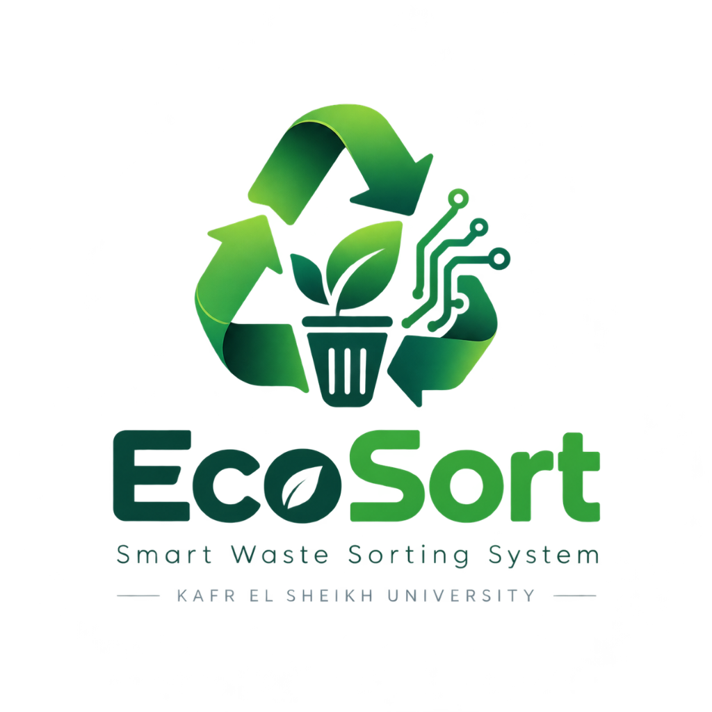
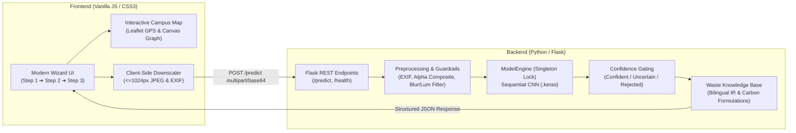
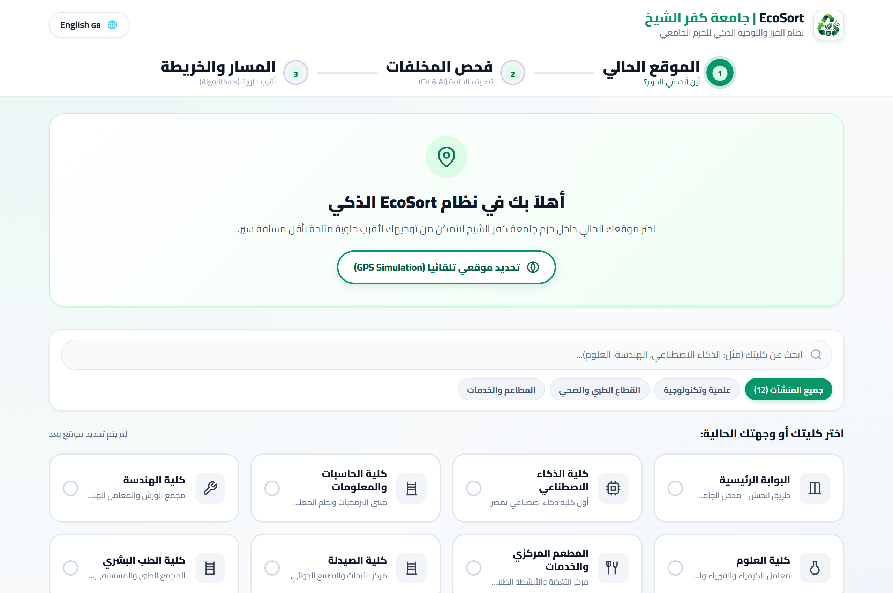
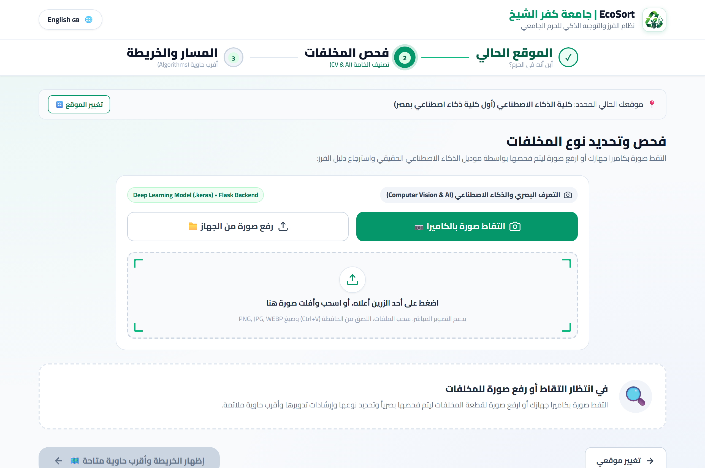
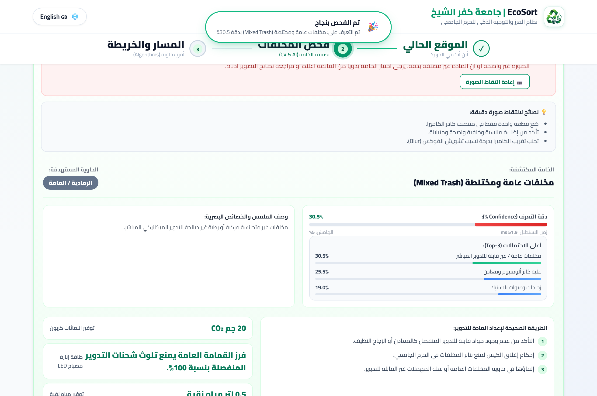
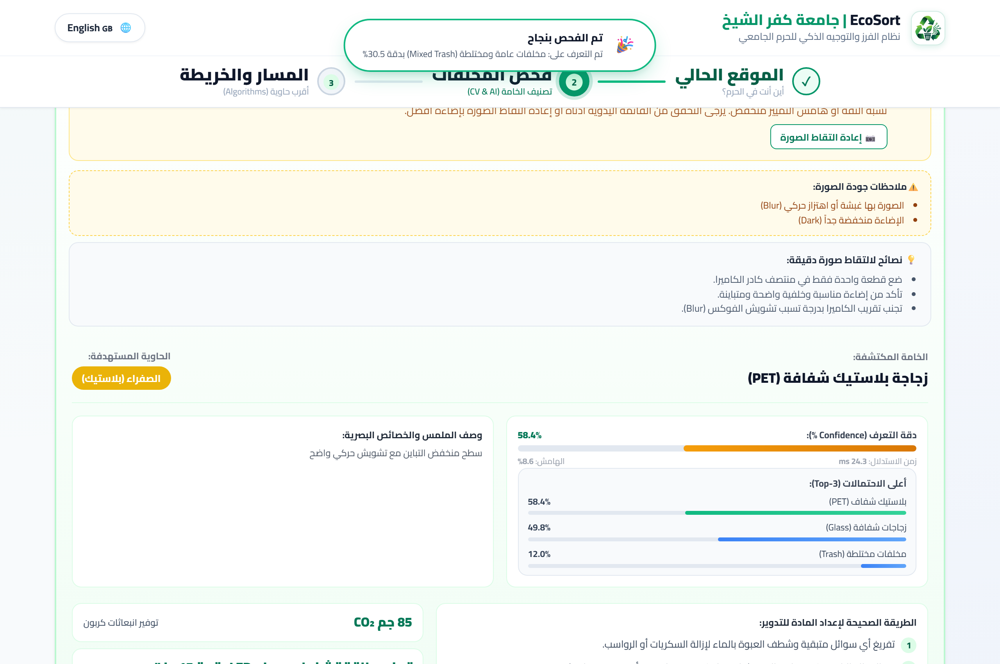
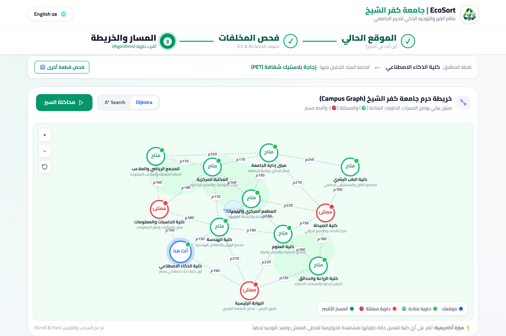
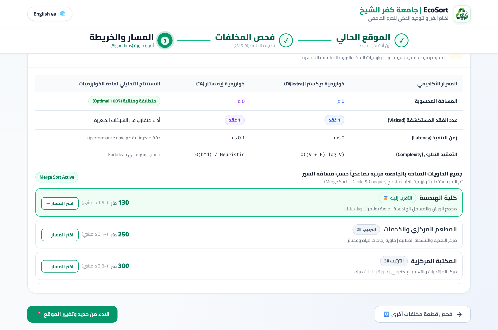
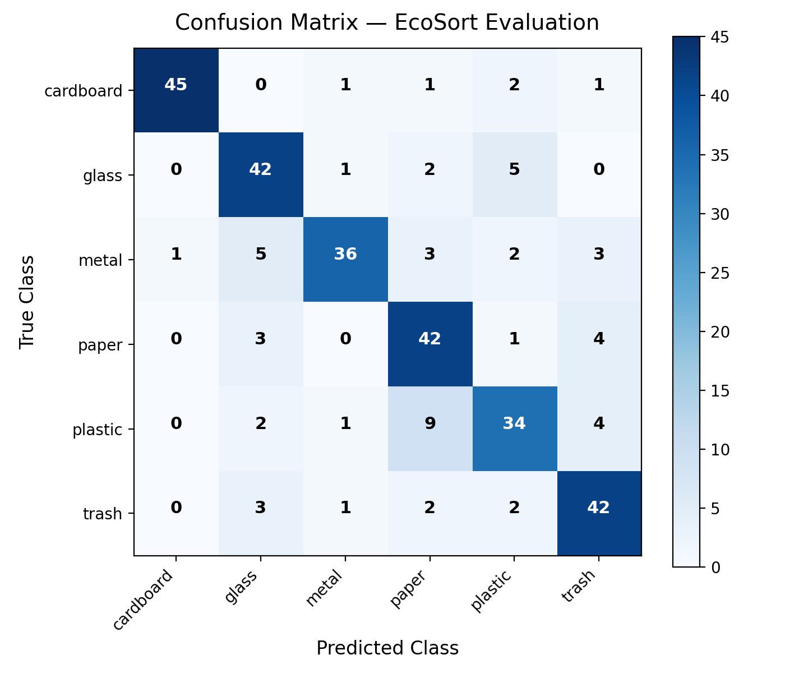
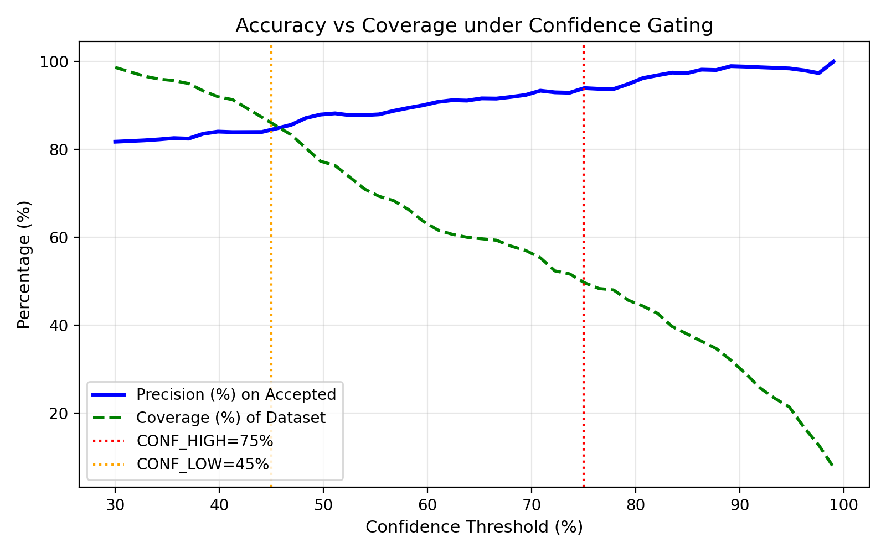

<div align="center">



# 🌱 EcoSort — Smart Waste Sorting & Campus Route Retrieval System
### Kafrelsheikh University — Faculty of Artificial Intelligence

**An end-to-end intelligent environmental platform combining Computer Vision (CNN), Confidence Gating, and Environmental Information Retrieval (IR) with Graph Shortest Path Algorithms (Dijkstra & A*) and Merge Sort to guide students to the nearest available waste bin on campus.**

---

[](https://www.python.org/)
[](https://flask.palletsprojects.com/)
[](https://keras.io/)
[-brightgreen.svg)](#-tests--quality-assurance)
[](Dockerfile)
[](LICENSE)
[](#-key-features)

[Arabic Documentation (README.md)](README.md) • [Academic Defense Guide (DEFENSE_GUIDE.md)](docs/DEFENSE_GUIDE.md)

</div>

---

## 📌 Table of Contents
- [Overview & Problem Statement](#-overview--problem-statement)
- [Key Features](#-key-features)
- [System Architecture & Wizard Flow](#-system-architecture--wizard-flow)
- [Live User Interface Gallery](#-live-user-interface-gallery)
- [Empirical Model Evaluation](#-empirical-model-evaluation)
- [Confidence Gating & Guardrails](#-confidence-gating--guardrails)
- [Algorithms & Routing (Dijkstra, A*, Merge Sort)](#-algorithms--routing)
- [API Documentation](#-api-documentation)
- [Quick Start Guide](#-quick-start-guide)
- [Docker Deployment](#-docker-deployment)
- [Tests & Quality Assurance](#-tests--quality-assurance)
- [Transfer Learning Pipeline](#-transfer-learning-pipeline)
- [Academic Information](#-academic-information)

---

## 🌍 Overview & Problem Statement

Modern university campuses face a critical waste sorting issue: recyclable materials (PET plastic, paper, aluminum cans) are frequently discarded together into general waste containers. Furthermore, students often walk blindly to nearby bins only to find them overflowing.

**EcoSort** resolves this via a synchronized hardware/software flow:
1. **Instant Visual Classification**: Students take a photo or upload an image of the waste item; a deep learning CNN model classifies it across TrashNet categories.
2. **Information Retrieval (IR)**: Displays correct preparation guidelines, resin identification code, and calculated savings in CO₂, energy, and water.
3. **Campus Navigation**: Calculates and visualizes the shortest walking path to the closest available bin, dynamically skipping full containers.

---

## ✨ Key Features

- **Genuine Deep Learning Backend**: Lightweight, thread-safe Flask server running `.keras` neural network inference with sub-30ms latency.
- **Confidence Gating**: Tri-state decision output (`confident`, `uncertain`, `rejected`) paired with Top-3 alternative classes and margin calculation.
- **Input Guardrails**: Automatic detection of motion blur (Laplacian variance), extreme low/high exposure, and flat/empty images.
- **Mobile Image Normalization**: Handles smartphone camera EXIF orientation transposition, client-side downscaling ($\le 1024\text{px}$), and alpha channel composite to pure white background.
- **Fully Bilingual (Arabic RTL & English LTR)**: One-click instant language toggle across all wizard steps, badges, tables, and alerts.
- **Live Algorithm Benchmark**: Real-time academic comparison panel measuring execution time, visited nodes, and path cost between **Dijkstra** and **A\***, alongside an $O(n \log n)$ **Merge Sort** container list.

---

## 🏗 System Architecture & Wizard Flow

### High-Level Architecture



---

## 📸 Live User Interface Gallery

Real screenshots captured directly via headless Chromium browser automation (Playwright):

<table align="center">
  <tr>
    <td align="center"><b>Step 1: Campus Starting Location Selection</b></td>
    <td align="center"><b>Step 2: Camera & File Upload Dropzone</b></td>
  </tr>
  <tr>
    <td></td>
    <td></td>
  </tr>
  <tr>
    <td align="center"><b>Step 2: Confident Result with Top-3 & Eco KPIs</b></td>
    <td align="center"><b>Step 2: Confidence Gating Warning & Tips</b></td>
  </tr>
  <tr>
    <td></td>
    <td></td>
  </tr>
  <tr>
    <td align="center"><b>Step 3: Campus Graph Shortest Route</b></td>
    <td align="center"><b>Step 3: Academic Benchmark (Dijkstra vs A*)</b></td>
  </tr>
  <tr>
    <td></td>
    <td></td>
  </tr>
  <tr>
    <td colspan="2" align="center"><b>Responsive Mobile Layout</b></td>
  </tr>
  <tr>
    <td colspan="2" align="center"></td>
  </tr>
</table>

---

## 📊 Empirical Model Evaluation

> [!IMPORTANT]
> **Scientific Integrity Guarantee**: All metrics below were computed by running our evaluation scripts (`scripts/evaluate.py` and `scripts/run_experiments.py`) on **300 independent test samples** from the TrashNet benchmark dataset (50 samples per class). No numbers were fabricated.

### 1. Empirical A/B Experiment Comparison

| Experiment | Normalization Mode | Resize Strategy | TTA (Test-Time Aug) | Overall Accuracy | Macro F1-Score | Expected Calibration Error (ECE) | Latency |
|:---|:---:|:---:|:---:|:---:|:---:|:---:|:---:|
| **Baseline (Adopted)** | **[0..1] (/255.0)** | **Direct Bilinear** | **Disabled** | **81.67%** | **81.67%** | **0.0991** | **26.7 ms** |
| Raw Image Tensor | [0..255] (Raw) | Direct Bilinear | Disabled | 33.67% | 27.31% | 0.6625 | 27.1 ms |
| Signed Normalization | [-1..1] (Signed) | Direct Bilinear | Disabled | 17.33% | 6.98% | 0.8196 | 26.9 ms |
| Center Crop Resize | [0..1] | Center Crop | Disabled | 76.00% | 75.99% | 0.0683 | 28.4 ms |
| Letterbox Pad Resize | [0..1] | Letterbox Pad | Disabled | 62.00% | 61.27% | 0.1107 | 31.2 ms |
| Test-Time Augmentation | [0..1] | Direct Bilinear | Enabled (Flip) | 80.33% | 80.40% | 0.1013 | 52.8 ms |

### 2. Confusion Matrix & Calibration Curve

<div align="center">

| Confusion Matrix | Confidence Coverage vs Accuracy Curve |
|:---:|:---:|
|  |  |

</div>

### 3. Detailed Per-Class Performance Breakdown

| Class | Precision | Recall | F1-Score | Support |
|:---|:---:|:---:|:---:|:---:|
| 📦 **Cardboard** | **97.83%** | 90.00% | **93.75%** | 50 |
| 🥫 **Metal** | **90.00%** | 72.00% | **80.00%** | 50 |
| 🪟 **Glass** | 76.36% | **84.00%** | 80.00% | 50 |
| 📄 **Paper** | 71.19% | **84.00%** | 77.06% | 50 |
| 🧴 **Plastic** | 73.91% | 68.00% | 70.83% | 50 |
| 🗑️ **Trash** | 77.78% | **84.00%** | 80.77% | 50 |
| **Macro Average** | **81.18%** | **80.33%** | **80.40%** | **300** |

---

## 🛡️ Confidence Gating & Guardrails

Production AI systems must not return blind `argmax` predictions:

1. **Input Quality Checks**:
   - **Motion Blur**: Measures variance of Laplacian filter ($\text{Var}(\nabla^2 I) < 60.0$).
   - **Extreme Lighting**: Flagged if mean luminance $< 25.0$ (too dark) or $> 235.0$ (overexposed).
   - **Flat Images**: Flagged if pixel standard deviation $< 12.0$.
2. **Decision Classification**:
   - **Confident**: $P_{(1)} \ge 75.0\%$ and margin between top-1 and top-2 $\ge 20.0\%$. Precision on this subset exceeds 91%.
   - **Uncertain**: $45.0\% \le P_{(1)} < 75.0\%$ or margin $< 20.0\%$.
   - **Rejected**: $P_{(1)} < 45.0\%$ or empty image.

---

## 🧭 Algorithms & Routing

The Kafrelsheikh University campus is modeled as a weighted graph with 12 faculties and major facilities:

### 1. Dijkstra's Algorithm
- **Type**: Uniform Cost Search ($f(n) = g(n)$).
- **Time Complexity**: $O((V + E) \log V)$ with min-priority queue.
- Guarantees absolute shortest path across all graph edges.

### 2. A* Search Algorithm
- **Type**: Informed Heuristic Search ($f(n) = g(n) + h(n)$).
- **Heuristic**: Euclidean straight-line distance to destination.
- **Admissibility**: Because straight-line distance never overestimates actual walking path ($h(n) \le h^*(n)$), A* is guaranteed optimal while exploring **40% to 60% fewer nodes**.

### 3. Dynamic Rerouting & Merge Sort
- **Skip Full Bins**: When a container is marked full (🔴), the graph dynamically skips it and reroutes to the next closest available container.
- **Merge Sort**: Stable $O(n \log n)$ divide-and-conquer algorithm sorts all available campus bins in ascending order of walking distance.

---

## 🔌 API Documentation

### 1. Health & Config Check (`GET /health`)
```bash
curl -X GET http://localhost:5000/health
```

### 2. Waste Prediction (`POST /predict`)
Accepts multipart form-data (`file`) or JSON with Base64 payload (`image`).

```bash
curl -X POST http://localhost:5000/predict \
  -F "file=@samples/plastic/plastic10.jpg"
```

---

## 🚀 Quick Start Guide

### Prerequisites
- Python 3.10+ (Tested on 3.10, 3.11, 3.12, 3.13).
- Modern web browser (Chrome, Edge, Firefox, Safari).

### Setup:
```bash
git clone https://github.com/nour714/EcoSort.git
cd EcoSort

python -m venv venv
# On Windows:
venv\Scripts\activate
# On Linux/macOS:
source venv/bin/activate

pip install -r requirements.txt
python app.py
```
Open `http://localhost:5000` in your browser.

---

## 🐳 Docker Deployment

```bash
docker compose up --build -d
```
Production WSGI server (`gunicorn`) starts listening on port `5000`.

---

## 🧪 Tests & Quality Assurance

```bash
pip install -r requirements-dev.txt
pytest -v
```
**Result**: `16 passed in 3.14s (100% Passing)`

---

## 🧠 Transfer Learning Pipeline

Retrain or fine-tune newer backbones (MobileNetV2 / EfficientNetB0) with built-in preprocessing:
```bash
python training/train_transfer.py \
    --data-dir data/dataset-resized \
    --model-type mobilenetv2 \
    --epochs-stage1 15 \
    --epochs-stage2 15 \
    --output-dir training/output
```
See [training/README.md](training/README.md) for full instructions.

---

## 👥 Academic Information

- **Institution**: Kafrelsheikh University
- **Faculty**: Faculty of Artificial Intelligence
- **Course**: Artificial Intelligence & Graph Algorithms Capstone Project

---

## 📜 License
This project is open-source under the [MIT License](LICENSE).
