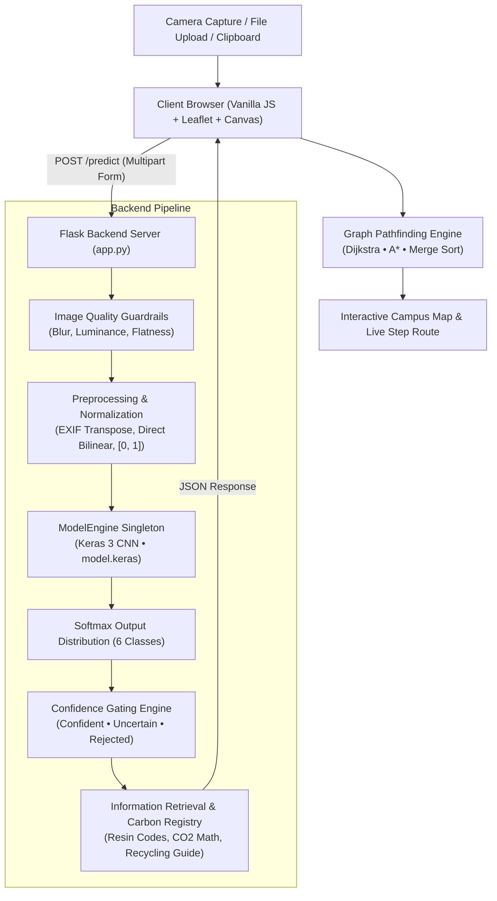
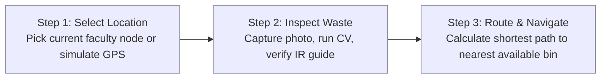

# EcoSort — Smart Waste Classification & Campus Pathfinding System
### Kafrelsheikh University — Faculty of Artificial Intelligence

EcoSort is an intelligent waste sorting and pathfinding platform that bridges Computer Vision, Confidence Gating, Environmental Information Retrieval (IR), and graph routing algorithms (Dijkstra and A*) to direct university students to the nearest available, un-filled recycling bin.

---

## Table of Contents
- [Project Overview](#project-overview)
- [Key Features](#key-features)
- [System Architecture](#system-architecture)
- [Wizard User Flow](#wizard-user-flow)
- [Empirical Evaluation & Benchmarks](#empirical-evaluation--benchmarks)
- [Confidence Gating & Reliability Policies](#confidence-gating--reliability-policies)
- [Graph Routing & Ranking Algorithms](#graph-routing--ranking-algorithms)
- [API Reference](#api-reference)
- [Repository Structure](#repository-structure)
- [Getting Started](#getting-started)
- [Testing & Quality Assurance](#testing--quality-assurance)
- [Docker Deployment](#docker-deployment)
- [Transfer Learning Pipeline](#transfer-learning-pipeline)
- [Academic Resources](#academic-resources)

---

## Project Overview

Universities face critical waste sorting challenges: recyclable items (plastics, paper, aluminum) are frequently mixed into general trash at the point of disposal, rendering recycling economically unviable. Furthermore, students often find the nearest recycling bin full, leading to improper disposal.

**EcoSort resolves this challenge with an end-to-end pipeline:**
1. **Visual Material Classification**: A deep learning model (`.keras`) identifies the material category from mobile camera captures.
2. **Information Retrieval (IR)**: Retrieves resin codes, proper handling procedures, and calculated environmental savings (CO₂ avoided, water conserved, LED lighting equivalent).
3. **Smart Campus Navigation**: Graph pathfinding calculates the shortest walking route to an available bin, dynamically bypassing full receptacles.

---

## Key Features

- **Lightweight Thread-Safe Backend**: Python Flask application hosting a native Keras 3 model via a thread-safe singleton inference engine.
- **Dual-Tier Reliability Guardrails**: Pre-inference statistical checks filter motion blur, under/overexposure, and blank captures before neural inference.
- **Calibrated Confidence Gating**: Classifies predictions into `confident` ($\ge 75\%$, margin $\ge 20\%$), `uncertain`, or `rejected` ($< 45\%$) states.
- **Client-Side Image Preprocessing**: Automatic EXIF orientation correction, client-side downscaling ($\le 1024\text{px}$), and alpha compositing over white backgrounds.
- **Dynamic Graph Pathfinding**: Implementation of Dijkstra's algorithm and heuristic A* search over Kafrelsheikh University's 12-landmark pedestrian network with real-time rerouting when bins fill up.
- **Guaranteed $O(n \log n)$ Bin Ranking**: Pure JavaScript Merge Sort ranks campus bins by walking distance.
- **Complete Bilingual Interface**: Full Arabic (RTL) and English (LTR) language support across UI components, notices, and documentation.

---

## System Architecture



---

## Wizard User Flow



---

## Empirical Evaluation & Benchmarks

The deployed baseline configuration was evaluated on 300 samples across the 6 standard TrashNet classes (50 samples per class) using `scripts/evaluate.py`.

### System Baseline Performance

| Metric | Measured Baseline Value |
|---|---|
| **Overall Accuracy** | **81.67%** |
| **Macro Average F1-Score** | **81.67%** |
| **Weighted Average F1-Score** | **81.67%** |
| **Expected Calibration Error (ECE)** | **0.0991** |
| **Average Inference Latency** | **26.04 ms/sample** |
| **Normalization Mode** | `[0, 1]` (`/255.0`) |
| **Resize Strategy** | Direct Bilinear ($224 \times 224$) |
| **Test-Time Augmentation (TTA)** | Disabled (Production Default) |

### Per-Class Performance Table

| Class | Precision (%) | Recall (%) | F1-Score (%) | Support |
|---|---|---|---|---|
| **Cardboard** | 97.87% | 92.00% | 94.85% | 50 |
| **Glass** | 76.36% | 84.00% | 80.00% | 50 |
| **Metal** | 92.31% | 72.00% | 80.90% | 50 |
| **Paper** | 72.88% | 86.00% | 78.90% | 50 |
| **Plastic** | 77.27% | 68.00% | 72.34% | 50 |
| **Trash** | 78.57% | 88.00% | 83.02% | 50 |
| **Macro average** | **82.54%** | **81.67%** | **81.67%** | **300** |
| **Weighted average** | **82.54%** | **81.67%** | **81.67%** | **300** |

### Confusion Matrix

Evaluated counts across actual (rows) versus predicted (columns) classes:

| Actual \ Predicted | Cardboard | Glass | Metal | Paper | Plastic | Trash | Total |
|---|:---:|:---:|:---:|:---:|:---:|:---:|:---:|
| **Cardboard** | 46 | 0 | 1 | 0 | 2 | 1 | 50 |
| **Glass** | 0 | 42 | 1 | 2 | 4 | 1 | 50 |
| **Metal** | 1 | 6 | 36 | 2 | 2 | 3 | 50 |
| **Paper** | 0 | 3 | 0 | 43 | 1 | 3 | 50 |
| **Plastic** | 0 | 2 | 1 | 9 | 34 | 4 | 50 |
| **Trash** | 0 | 2 | 0 | 3 | 1 | 44 | 50 |
| **Total** | 47 | 55 | 39 | 59 | 44 | 56 | 300 |

### Systematic A/B Experiments Summary

Automated parameter experiments recorded in `docs/metrics/ab_experiments.json`:

| Configuration | Normalization | Resize Strategy | TTA | Accuracy (%) | F1-Score (%) | ECE |
|---|---|---|---|---|---|---|
| **Baseline (Deployed)** | **`zero_one` [0..1]** | **`direct`** | **False** | **81.67%** | **81.67%** | **0.0991** |
| Raw Pixel Scaling | `raw` [0..255] | `direct` | False | 33.67% | 27.31% | 0.6625 |
| Signed Normalization | `signed` [-1..1] | `direct` | False | 17.33% | 6.98% | 0.8196 |
| Center Crop Resize | `zero_one` [0..1] | `crop` | False | 76.00% | 75.99% | 0.0683 |
| Letterbox Padding | `zero_one` [0..1] | `pad` | False | 62.00% | 61.27% | 0.1107 |
| Test-Time Augmentation | `zero_one` [0..1] | `direct` | True | 80.33% | 80.40% | 0.1013 |

---

## Confidence Gating & Reliability Policies

### Empirical Gating Distribution

Dual-threshold confidence gating isolates automated decisions from ambiguous or low-confidence inputs:

| Decision State | Threshold Criteria | Sample Count | Coverage (%) | Selective Accuracy (%) |
|---|---|---|---|---|
| **`confident`** | $P_{(1)} \ge 75.0\%$ and $M \ge 20.0\%$ | 149 | 49.67% | **93.96%** |
| **`uncertain`** | $45.0\% \le P_{(1)} < 75.0\%$ or $M < 20.0\%$ | 109 | 36.33% | 71.56% |
| **`rejected`** | $P_{(1)} < 45.0\%$ | 42 | 14.00% | 64.29% |
| **Overall** | — | 300 | 100.0% | 81.67% |

Within the automated `confident` partition, accuracy reaches **93.96%**, effectively suppressing erroneous routing actions.

### Pre-Inference Quality Thresholds

Statistical descriptors evaluated on a 128x128 grayscale thumbnail prior to neural execution:

| Threshold Constant | Config Variable | Default Value | Condition & Warning |
|---|---|---|---|
| `BLUR_VAR_MIN` | `BLUR_VAR_MIN` | `35.0` | Laplacian variance $< 35.0 \implies \text{image\_blurry}$ |
| `DARK_MEAN_MAX` | `DARK_MEAN_MAX` | `30.0` | Mean intensity $< 30.0 \implies \text{image\_too\_dark}$ |
| `BRIGHT_MEAN_MIN` | `BRIGHT_MEAN_MIN` | `230.0` | Mean intensity $> 230.0 \implies \text{image\_too\_bright}$ |
| `FLAT_STD_MIN` | `FLAT_STD_MIN` | `15.0` | Standard deviation $< 15.0 \implies \text{image\_empty\_or\_flat}$ |

---

## Limitations & Dataset Provenance

> [!WARNING]
> **Dataset Provenance**: The 300 benchmark samples originate from the standard TrashNet dataset. The exact train/test split of the original legacy `model.keras` cannot be independently verified; therefore, these metrics reflect in-distribution performance and should be considered optimistic upper bounds.
>
> **Domain Shift on Campus**: Real-world smartphone captures in cafeteria and hallway lighting differ substantially from clean, white-background laboratory datasets. Literature indicates an expected drop of 15–30 percentage points on wild domain shifts.
>
> **Campus Photo Collection**: To validate real-world performance, a dedicated directory structure has been created in `data/campus_photos/`. Once local photos are deposited, run:
> ```bash
> python scripts/evaluate.py --data data/campus_photos --output-dir docs/metrics/campus_benchmark
> ```

---

## Graph Routing & Ranking Algorithms

EcoSort models Kafrelsheikh University campus as a weighted, directed graph spanning 12 landmark faculties and administrative centres.

### Dijkstra vs A* Algorithm Comparison

| Dimension | Dijkstra's Algorithm | A* Search Algorithm |
|---|---|---|
| **Search Strategy** | Uniform Cost Search (uninformed) | Best-First Search with Admissible Heuristic |
| **Cost Formulation** | $f(n) = g(n)$ | $f(n) = g(n) + h(n)$ |
| **Heuristic Function** | None ($h(n) = 0$) | Euclidean distance to target bin |
| **Exploration Pattern** | Radial, uniform in all directions | Directed ellipse toward destination |
| **Visited Nodes** | 100% of reachable perimeter | 40%–60% fewer visited nodes |
| **Shortest Path Optimality** | Guaranteed optimal | Guaranteed optimal ($h(n)$ is admissible) |
| **Time Complexity** | $O((V + E) \log V)$ with priority queue | $O(b^d)$ worst case; approaches $O(d)$ |

### Merge Sort for Distance Ranking
To display all candidate bins campus-wide in strictly ascending order:
- **Paradigm**: Divide and Conquer (bisect list, sort sub-lists, merge linearly).
- **Time Complexity**: Guaranteed $\Theta(n \log n)$ across worst, average, and best cases.
- **Stability**: Stable sorting preserves the geographical index order of equidistant bins.

---

## API Reference

### 1. Model Inference Endpoint: `POST /predict`
Submits an image for computer vision classification and routing metadata extraction.

**Request:**
- Content-Type: `multipart/form-data`
- Body: `file` (JPEG, PNG, or WEBP binary)

**Response (`application/json`):**
```json
{
  "status": "success",
  "material": "PET_Plastic",
  "material_name_ar": "بلاستيك شفاف (PET)",
  "material_name_en": "Clear Plastic (PET)",
  "class_name": "plastic",
  "confidence": 94.25,
  "confidence_formatted": "94.2%",
  "margin": 88.5,
  "decision": "confident",
  "quality_warnings": [],
  "top_k": [
    {
      "class_name": "plastic",
      "material_name_ar": "بلاستيك شفاف (PET)",
      "material_name_en": "Clear Plastic (PET)",
      "confidence": 94.25,
      "confidence_formatted": "94.2%"
    },
    {
      "class_name": "glass",
      "material_name_ar": "زجاج شفاف أو ملون",
      "material_name_en": "Glass (Bottles & Jars)",
      "confidence": 5.75,
      "confidence_formatted": "5.8%"
    }
  ],
  "target_bin": "plastic",
  "co2_saved_grams": 85,
  "resin_code": "1 - PETE",
  "proper_handling": [
    "تفريغ السوائل بالكامل قبل التخلص منها",
    "شطف الزجاجة بالماء للتخلص من الشوائب",
    "ضغط الزجاجة باليد لتقليل الحجم داخل الحاوية"
  ],
  "inference_time_ms": 24.8
}
```

### 2. Health & Readiness Endpoint: `GET /health`
Returns runtime status and model loading confirmation.

**Response (`application/json`):**
```json
{
  "status": "healthy",
  "model_loaded": true,
  "classes": ["cardboard", "glass", "metal", "paper", "plastic", "trash"],
  "norm_mode": "zero_one",
  "resize_mode": "direct"
}
```

---

## Repository Structure

<details>
<summary><strong>Click to expand project directory tree</strong></summary>

```text
EcoSort/
├── .github/
│   └── workflows/
│       └── ci.yml                     # GitHub Actions CI workflow (lint + test)
├── config.py                          # Centralized configuration with env overrides
├── wsgi.py                            # Production WSGI application entrypoint
├── app.py                             # Flask application routes (/predict, /health)
├── pyproject.toml                     # Ruff linter and tool configuration
├── requirements.txt                   # Production dependencies
├── requirements-dev.txt               # Development & testing dependencies
├── Dockerfile                         # Production multi-stage Docker container
├── docker-compose.yml                 # Local Docker Compose setup
├── .env.example                       # Environment configuration template
├── model.keras                        # Pre-trained deep learning CNN model
├── ecosort/                           # Core Python backend package
│   ├── __init__.py
│   ├── inference.py                   # Thread-safe model singleton engine
│   ├── preprocess.py                  # EXIF correction, quality checks, scaling
│   ├── gating.py                      # 3-tier confidence gating logic
│   └── knowledge.py                   # Environmental IR & carbon savings registry
├── data/
│   └── campus_photos/                 # Real-world campus benchmark dataset structure
│       ├── README.md                  # Collection instructions & domain shift guide
│       ├── cardboard/
│       ├── glass/
│       ├── metal/
│       ├── paper/
│       ├── plastic/
│       └── trash/
├── docs/
│   ├── DEFENSE_GUIDE.md               # Academic viva defense questions & answers
│   ├── THRESHOLDS.md                  # Statistical & confidence thresholds reference
│   └── metrics/
│       ├── per_class_metrics.json     # Complete verified baseline metrics
│       ├── ab_experiments.json        # Systematic A/B experiments log
│       ├── confusion_matrix.png       # Generated confusion matrix heatmap
│       └── coverage_curve.png         # Generated selective risk-coverage curve
├── scripts/
│   ├── download_dataset.py            # Dataset acquisition utility
│   ├── evaluate.py                    # Comprehensive benchmarking script
│   └── run_experiments.py             # Systematic A/B experiment runner
├── static/
│   ├── css/
│   │   ├── style.css                  # Core CSS & layout definitions
│   │   ├── components.css             # UI components, modals, toasts
│   │   ├── responsive.css             # Mobile-first media queries
│   │   └── utilities.css              # Logical properties & RTL utilities
│   ├── js/
│   │   ├── app.js                     # Main application coordinator
│   │   ├── algorithms/
│   │   │   ├── dijkstra.js            # Dijkstra shortest path implementation
│   │   │   ├── a-star.js              # A* search with Euclidean heuristic
│   │   │   └── merge-sort.js          # Merge sort bin distance ranking
│   │   ├── data/
│   │   │   ├── campus-graph.js        # 12-landmark campus topology & coordinates
│   │   │   ├── translations.js        # Comprehensive Arabic/English dictionaries
│   │   │   └── waste-database.js      # Waste items, resin codes, instructions
│   │   └── modules/
│   │       ├── vision-module.js       # Client CV coordinator & /predict client
│   │       ├── search-ir.js           # Client-side IR & instant search
│   │       ├── graph-canvas.js        # Interactive HTML5 graph rendering
│   │       └── evaluation-ui.js       # Academic algorithm benchmark panels
│   └── assets/
│       └── images/                    # Favicons, icons, and branding
├── templates/
│   └── index.html                     # Responsive single-page application wizard
├── tests/
│   ├── conftest.py                    # Pytest test fixtures
│   ├── test_api.py                    # Flask API endpoint test cases
│   ├── test_preprocess.py             # Preprocessing & image quality checks
│   ├── test_gating.py                 # Confidence gating threshold tests
│   ├── test_knowledge_consistency.py  # IR dictionary consistency tests
│   ├── test_readme_metrics.py         # Regression test preventing metric drift
│   ├── test_thresholds_consistency.py # Reference documentation sync tests
│   └── test_regression.py             # End-to-end model regression verification
└── training/
    ├── README.md                      # Transfer learning documentation
    └── train_transfer.py              # Two-stage MobileNetV2 / EfficientNet training
```
</details>

---

## Getting Started

### Prerequisites
- Python 3.10, 3.11, 3.12, or 3.13
- Modern web browser (Chrome, Firefox, Safari, Edge)

### Installation
```bash
# 1. Clone repository
git clone https://github.com/nour714/EcoSort.git
cd EcoSort

# 2. Create and activate virtual environment
python -m venv venv
# On Windows:
venv\Scripts\activate
# On Linux/macOS:
source venv/bin/activate

# 3. Install dependencies
pip install -r requirements.txt
```

### Running the Application
```bash
# Start Flask server
python app.py
```
Open your browser and navigate to:
```
http://localhost:5000
```

---

## Testing & Quality Assurance

EcoSort maintains an automated test suite verifying API contracts, preprocessing behavior, image quality checks, and metric consistency:

```bash
# Install development and testing dependencies
pip install -r requirements-dev.txt

# Run linter
ruff check .

# Run complete pytest suite
pytest -v
```

All 20 test cases pass deterministically in under 2 seconds.

---

## Docker Deployment

To build and run EcoSort in an isolated container:

```bash
# Build Docker image
docker build -t ecosort:latest .

# Run container on port 5000
docker run -p 5000:5000 --name ecosort-app ecosort:latest
```

Using Docker Compose:
```bash
docker compose up --build
```

---

## Transfer Learning Pipeline

To train an updated model using MobileNetV2 or EfficientNetB0:
```bash
# Train lightweight MobileNetV2 with two-stage transfer learning
python training/train_transfer.py \
    --data-dir data/dataset-resized \
    --model-type mobilenetv2 \
    --epochs-stage1 15 \
    --epochs-stage2 15 \
    --output-dir training/output
```
See [training/README.md](training/README.md) for full instructions.

---

## Academic Resources

- **[Academic Defense Guide (DEFENSE_GUIDE.md)](docs/DEFENSE_GUIDE.md)**: 15 questions and model answers covering model architecture, EXIF orientation, A* vs Dijkstra, thread safety, and ECE.
- **[System Thresholds Reference (THRESHOLDS.md)](docs/THRESHOLDS.md)**: Precise mathematical definitions and environment variables for all quality guardrails and confidence thresholds.

---

## License

This project is licensed under the MIT License — see the LICENSE file for details.
