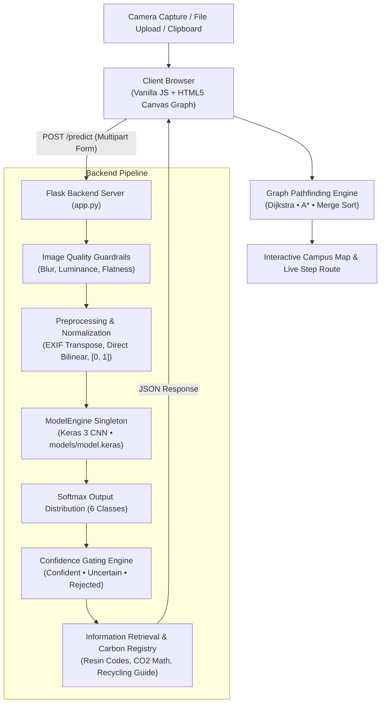
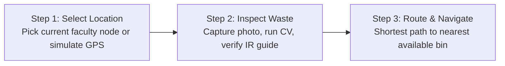

<div align="center">


# EcoSort

### Smart Waste Classification & Campus Pathfinding System

**Snap it. Sort it. Find the nearest free bin.**

*Kafrelsheikh University — Faculty of Artificial Intelligence*

<br>

[](https://www.python.org/)
[](https://flask.palletsprojects.com/)
[](https://tensorflow.org/)
[](https://vercel.com/)
[](https://www.docker.com/)
[](#system-baseline-performance)
[](LICENSE)

<br>

[Overview](#-project-overview) • [Features](#-key-features) • [Architecture](#%EF%B8%8F-system-architecture) • [Benchmarks](#-empirical-evaluation--benchmarks) • [API](#-api-reference) • [Getting Started](#-getting-started) • [Deployment](#%EF%B8%8F-deployment-flask-vs-vercel)

</div>

---

## 🌍 Project Overview

Universities face a persistent waste-sorting problem: recyclable items (plastic, paper, aluminum) end up mixed with general trash, which makes recycling economically unviable. On top of that, students often find the nearest bin already full and dispose of waste improperly.

EcoSort solves this with an end-to-end pipeline:

| Step | Stage | What it does |
| :---: | :--- | :--- |
| **1️⃣** | **Visual Material Classification** | A deep learning model (`.keras` / `.tflite`) identifies the material category from a mobile camera capture. |
| **2️⃣** | **Information Retrieval (IR)** | Returns resin codes, handling instructions, and environmental savings (CO₂ avoided, water conserved, LED lighting equivalent). |
| **3️⃣** | **Smart Campus Navigation** | Graph pathfinding finds the shortest walking route to an available bin and automatically bypasses full ones. |

---

## ✨ Key Features

- **🧵 Lightweight, thread-safe backend**: Flask app serving a native Keras 3 model through a thread-safe singleton inference engine, plus a serverless Vercel runtime powered by Google LiteRT.
- **🛡️ Dual-tier reliability guardrails**: Statistical checks reject blurry, under/over-exposed, and blank captures before neural inference.
- **🎯 Calibrated confidence gating**: Every prediction is labeled confident (`P1 >= 75%`, `margin >= 20%`), uncertain, or rejected (`P1 < 45%`).
- **🖼️ Client-side preprocessing**: Automatic EXIF orientation correction, downscaling (max 1024px), and alpha compositing over white.
- **🗺️ Dynamic graph pathfinding**: Dijkstra and heuristic A* over a 12-landmark pedestrian network of Kafrelsheikh University, with real-time rerouting when bins fill up.
- **⚡ Guaranteed O(n log n) bin ranking**: Pure JavaScript Merge Sort ranks bins by walking distance.
- **🌐 Fully bilingual UI**: Complete Arabic (RTL) and English (LTR) support across components, notices, and documentation.

---

## 🏗️ System Architecture



---

## 🧭 Wizard User Flow



---

## 📊 Empirical Evaluation & Benchmarks

The deployed baseline configuration was evaluated on 300 samples across the 6 standard TrashNet classes (50 samples per class) using `scripts/evaluate.py`.

### System Baseline Performance

| Metric | Measured Baseline Value |
| :--- | :--- |
| **Overall Accuracy** | **81.67%** |
| **Macro Average F1-Score** | **81.67%** |
| **Weighted Average F1-Score** | **81.67%** |
| **Expected Calibration Error (ECE)** | **0.0991** |
| **Average Inference Latency** | **26.04 ms/sample** |
| **Normalization Mode** | `[0, 1]` (`/255.0`) |
| **Resize Strategy** | Direct Bilinear (224×224) |
| **Test-Time Augmentation (TTA)** | Disabled (Production Default) |

### Per-Class Performance Table

| Class | Precision (%) | Recall (%) | F1-Score (%) | Support |
| :--- | :---: | :---: | :---: | :---: |
| **Cardboard** | 97.87% | 92.00% | 94.85% | 50 |
| **Glass** | 76.36% | 84.00% | 80.00% | 50 |
| **Metal** | 92.31% | 72.00% | 80.90% | 50 |
| **Paper** | 72.88% | 86.00% | 78.90% | 50 |
| **Plastic** | 77.27% | 68.00% | 72.34% | 50 |
| **Trash** | 78.57% | 88.00% | 83.02% | 50 |
| **Macro average** | **82.54%** | **81.67%** | **81.67%** | **300** |
| **Weighted average** | **82.54%** | **81.67%** | **81.67%** | **300** |

### Confusion Matrix

Evaluated counts across actual (rows) versus predicted (columns) classes:

| Actual \ Predicted | Cardboard | Glass | Metal | Paper | Plastic | Trash | Total |
| :--- | :---: | :---: | :---: | :---: | :---: | :---: | :---: |
| **Cardboard** | 46 | 0 | 1 | 0 | 2 | 1 | 50 |
| **Glass** | 0 | 42 | 1 | 2 | 4 | 1 | 50 |
| **Metal** | 1 | 6 | 36 | 2 | 2 | 3 | 50 |
| **Paper** | 0 | 3 | 0 | 43 | 1 | 3 | 50 |
| **Plastic** | 0 | 2 | 1 | 9 | 34 | 4 | 50 |
| **Trash** | 0 | 2 | 0 | 3 | 1 | 44 | 50 |
| **Total** | 47 | 55 | 39 | 59 | 44 | 56 | 300 |

### Systematic A/B Experiments Summary

Automated parameter experiments recorded in `docs/metrics/ab_experiments.json`:

| Configuration | Normalization | Resize Strategy | TTA | Accuracy (%) | F1-Score (%) | ECE |
| :--- | :--- | :--- | :---: | :---: | :---: | :---: |
| **✅ Baseline (Deployed)** | **`zero_one` [0..1]** | **`direct`** | **No** | **81.67%** | **81.67%** | **0.0991** |
| Raw Pixel Scaling | `raw` [0..255] | `direct` | No | 33.67% | 27.31% | 0.6625 |
| Signed Normalization | `signed` [-1..1] | `direct` | No | 17.33% | 6.98% | 0.8196 |
| Center Crop Resize | `zero_one` [0..1] | `crop` | No | 76.00% | 75.99% | 0.0683 |
| Letterbox Padding | `zero_one` [0..1] | `pad` | No | 62.00% | 61.27% | 0.1107 |
| Test-Time Augmentation | `zero_one` [0..1] | `direct` | Yes | 80.33% | 80.40% | 0.1013 |

---

## 🚦 Confidence Gating & Reliability Policies

### Empirical Gating Distribution

Dual-threshold confidence gating isolates automated decisions from ambiguous or low-confidence inputs:

| Decision State | Threshold Criteria | Sample Count | Coverage (%) | Selective Accuracy (%) |
| :--- | :--- | :---: | :---: | :---: |
| **🟢 `confident`** | `P1 >= 75.0%` and `margin >= 20.0%` | 149 | 49.67% | **93.96%** |
| **🟡 `uncertain`** | `45.0% <= P1 < 75.0%` or `margin < 20.0%` | 107 | 35.67% | 71.03% |
| **🔴 `rejected`** | `P1 < 45.0%` or `image_empty_or_flat` | 44 | 14.67% | 65.91% |
| **Overall** | — | 300 | 100.0% | 81.67% |

Within the automated `confident` partition, accuracy reaches **93.96%**, effectively suppressing erroneous routing actions.

### Pre-Inference Quality Thresholds

Statistical descriptors evaluated on a 128×128 grayscale thumbnail prior to neural execution:

| Constant | Config Variable | Default Value | Condition & Warning |
| :--- | :--- | :---: | :--- |
| `BLUR_VAR_MIN` | `BLUR_VAR_MIN` | `35.0` | Laplacian variance < 35.0 &rarr; `image_blurry` |
| `DARK_MEAN_MAX` | `DARK_MEAN_MAX` | `30.0` | Mean intensity < 30.0 &rarr; `image_too_dark` |
| `BRIGHT_MEAN_MIN` | `BRIGHT_MEAN_MIN` | `230.0` | Mean intensity > 230.0 &rarr; `image_too_bright` |
| `FLAT_STD_MIN` | `FLAT_STD_MIN` | `15.0` | Standard deviation < 15.0 &rarr; `image_empty_or_flat` |

---

## ⚠️ Limitations & Dataset Provenance

> [!WARNING]
> **Dataset provenance**: The 300 benchmark samples come from the standard TrashNet dataset. The exact train/test split of the original legacy `models/model.keras` cannot be independently verified, so these metrics reflect in-distribution performance and should be treated as optimistic upper bounds.
>
> **Domain shift on campus**: Real smartphone photos taken in cafeterias and hallways differ substantially from clean, white-background lab images. Real-world performance is likely lower.
>
> **Campus photo collection**: A dedicated directory exists at `data/campus_photos/`. Once local photos are added, run:
> ```bash
> python scripts/evaluate.py --data data/campus_photos --output-dir docs/metrics/campus_benchmark
> ```

---

## 🛣️ Graph Routing & Ranking Algorithms

EcoSort models the pedestrian network of Kafrelsheikh University campus as an illustrative, weighted graph spanning 12 landmark faculties and facilities. Edge weights are derived from real geographical coordinates (lat/lng) calculated via the Haversine formula scaled with a realistic pedestrian detour factor (1.15), ensuring `weight >= haversine` across all edges.

### Dijkstra vs A* Algorithm Comparison

| Dimension | Dijkstra's Algorithm | A* Search Algorithm |
| :--- | :--- | :--- |
| **Search Strategy** | Uniform Cost Search (uninformed) | Best-First Search with Admissible Heuristic |
| **Cost Formulation** | `f(n) = g(n)` | `f(n) = g(n) + h(n)` |
| **Heuristic Function** | None (`h(n) = 0`) | Haversine distance to target bin (`h(n) <= h*(n)`, consistent) |
| **Exploration Pattern** | Radial, uniform in all directions | Directed ellipse toward destination |
| **Shortest Path Optimality** | Guaranteed optimal | Guaranteed optimal (`h(n)` is admissible and consistent) |
| **Time Complexity** | `O((V + E) log V)` with priority queue | `O(b^d)` worst case; approaches `O(d)` |

### Merge Sort for Distance Ranking
Used to display all candidate bins campus-wide in strictly ascending distance order:
- **Paradigm**: Divide and Conquer (bisect list, sort sub-lists, merge linearly).
- **Time Complexity**: Guaranteed `O(n log n)` across worst, average, and best cases.
- **Stability**: Stable sorting preserves the geographical index order of equidistant bins.

---

## 🔌 API Reference

### `POST /predict` — Classify an image
Submits an image for computer vision classification and routing metadata extraction.

- **Content-Type**: `multipart/form-data`
- **Body**: `file` (JPEG, PNG, or WEBP binary)

<details>
<summary><strong>Example response (click to expand)</strong></summary>

```json
{
  "status": "success",
  "decision": "confident",
  "class_name": "plastic",
  "confidence": 94.2,
  "confidence_formatted": "94.2%",
  "margin": 88.5,
  "top_k": [
    {
      "class_name": "plastic",
      "material_name_ar": "بلاستيك عام وبوليمرات",
      "material_name_en": "General Plastic & Polymers",
      "confidence": 94.2,
      "confidence_formatted": "94.2%"
    },
    {
      "class_name": "glass",
      "material_name_ar": "زجاجات وعبوات زجاجية",
      "material_name_en": "Glass Bottle / Container",
      "confidence": 5.8,
      "confidence_formatted": "5.8%"
    }
  ],
  "quality_warnings": [],
  "tta_used": false,
  "model_version": "2.0.0",
  "inference_time_ms": 24.8,
  "material": "Plastic",
  "material_name_ar": "بلاستيك عام وبوليمرات",
  "material_name_en": "General Plastic & Polymers",
  "resin_code": null,
  "target_bin": "plastic",
  "bin_name_ar": "الحاوية الصفراء (بلاستيك)",
  "bin_name_en": "Yellow Bin (Plastics)",
  "bin_color": "#eab308",
  "co2_saved_grams": 85,
  "energy_saved": "توفير طاقة تعادل تشغيل مصباح موفر لمدة 6 ساعات لكل عبوة.",
  "energy_saved_en": "Saves enough energy to power an LED bulb for 6 hours per container.",
  "water_saved_liters": 2.1,
  "guide": [
    "تفريغ أي قطرات سوائل أو محتويات متبقية داخل العبوة تماماً.",
    "ضغط العبوة باليد لطرد الهواء وتقليص حجمها لتوفير المساحة بالحاوية.",
    "إعادة ربط الغطاء بإحكام حتى لا يفلت أثناء النقل وإعادة التدوير.",
    "إلقاء القطعة في الحاوية الصفراء المخصصة للمخلفات البلاستيكية."
  ],
  "guide_en": [
    "Completely drain any residual liquids or contents.",
    "Crush the plastic item flat to expel air and save bin volume.",
    "Screw the plastic cap back on tightly if applicable.",
    "Drop into the designated yellow plastic recycling bin."
  ],
  "texture_description_ar": "بلاستيك وبوليمرات متعددة، مرنة أو صلبة، ملمس أملس مع استجابة مرنة عند الضغط.",
  "texture_description_en": "Various polymer plastic, flexible or rigid, smooth finish with elastic deformation."
}
```
</details>

### `GET /health` — Readiness check
Returns runtime status and model-loading confirmation.

```json
{
  "status": "healthy",
  "model_loaded": true,
  "classes": ["cardboard", "glass", "metal", "paper", "plastic", "trash"],
  "norm_mode": "zero_one",
  "resize_mode": "direct"
}
```

---

## 📁 Repository Structure

<details>
<summary><strong>Click to expand the project directory tree</strong></summary>

```
EcoSort/
├── .github/
│   └── workflows/
│       └── ci.yml               # GitHub Actions CI (lint + test)
├── api/                         # Vercel serverless deployment
│   ├── index.py                 # Serverless WSGI/LiteRT entrypoint & proxy
│   └── requirements.txt         # Serverless Python dependencies (ai-edge-litert)
├── app.py                       # Flask routes (/predict, /health)
├── wsgi.py                      # Production WSGI entrypoint
├── index.html                   # Root static entrypoint for Vercel
├── vercel.json                  # Vercel routing, rewrites, security headers
├── ecosort/                     # Core Python backend package
│   ├── __init__.py
│   ├── config.py                # Centralized configuration with env overrides
│   ├── inference.py             # Thread-safe model singleton & gating
│   ├── knowledge.py             # Environmental IR & carbon savings registry
│   ├── preprocess.py            # EXIF correction, quality checks, scaling
│   └── rate_limiter.py          # Sliding-window in-memory IP rate limiter
├── models/
│   ├── model.keras              # Pre-trained CNN model
│   └── model.tflite             # Flatbuffer model for LiteRT inference
├── data/
│   ├── README.md                # Dataset documentation & evaluation guide
│   ├── benchmark/               # 300 TrashNet evaluation samples (6 classes)
│   └── campus_photos/           # Real-world campus photographs
│       ├── README.md            # Collection instructions & domain-shift guide
│       └── {cardboard,glass,metal,paper,plastic,trash}/
├── docs/
│   ├── DEFENSE_GUIDE.md         # Academic viva Q&A
│   ├── THRESHOLDS.md            # Statistical & confidence thresholds reference
│   └── metrics/
│       ├── ab_experiments.json  # A/B experiments log
│       └── per_class_metrics.json # Verified baseline metrics
├── scripts/
│   ├── download_dataset.py      # Dataset acquisition utility
│   ├── evaluate.py              # Benchmarking script
│   ├── run_experiments.py       # A/B experiment runner
│   └── sync_sources.py          # Single-source verification & sync utility
├── static/
│   ├── assets/images/           # Logo, favicons, icons, branding
│   ├── css/
│   │   ├── components.css       # UI components, modals, toasts
│   │   ├── responsive.css       # Mobile-first media queries
│   │   ├── style.css            # Core CSS & layout
│   │   └── utilities.css        # Logical properties & RTL utilities
│   └── js/                      # Client-side routing, algorithms, CV modules
├── templates/
│   └── index.html               # Responsive single-page wizard
├── tests/                       # Automated test suite (Pytest + Node)
├── training/
│   ├── README.md                # Transfer learning documentation
│   └── train_transfer.py        # Two-stage MobileNetV2 / EfficientNet training
├── .dockerignore
├── .env.example                 # Environment configuration template
├── .gitignore
├── Dockerfile                   # Production container (python:3.11-slim)
├── docker-compose.yml           # Local Docker Compose setup
├── LICENSE
├── pyproject.toml               # Ruff linter & tool configuration
├── README.md
├── requirements.txt             # Vercel serverless runtime deps
├── requirements-full.txt        # Flask server & Docker deps (TensorFlow, Keras)
└── requirements-dev.txt         # Dev & testing deps (inherits requirements-full.txt)
```
</details>

---

## 🚀 Getting Started

### Prerequisites
- Python 3.10, 3.11, 3.12, or 3.13
- A modern web browser (Chrome, Firefox, Safari, Edge)

### Dependency Files
EcoSort uses a three-way split, one file per deployment target:

| File | Target | Contents |
| :--- | :--- | :--- |
| **`requirements.txt`** | **Vercel Serverless only** | Flask, Pillow, numpy, ai-edge-litert — kept within Vercel's size limits |
| **`requirements-full.txt`** | **Docker Containers & Dedicated Flask Server** | Full deep learning runtime (`tensorflow==2.20.0`, `keras==3.13.2`, `gunicorn==23.0.0`, `Pillow`, `Flask`) |
| **`requirements-dev.txt`** | **Testing, CI & QA** | Extends `requirements-full.txt` with test frameworks (`pytest`, `ruff`, `scikit-learn`, `playwright`) |

### Installation
```bash
# 1. Clone the repository
git clone https://github.com/nour714/EcoSort.git
cd EcoSort

# 2. Create and activate a virtual environment
python -m venv venv

# Windows
venv\Scripts\activate
# Linux / macOS
source venv/bin/activate

# 3. Install dependencies:
# For full local development or Docker:
pip install -r requirements-full.txt

# Or for running the complete test suite:
pip install -r requirements-dev.txt

# Note: requirements.txt is used exclusively for Vercel serverless functions.
```

### Run the App
```bash
# Start Flask server
python app.py
```
Then open your browser and navigate to:
```
http://localhost:5000
```

---

## 🧪 Testing & Quality Assurance

The automated test suite verifies API contracts, preprocessing behavior, image-quality checks, confidence gating, graph algorithms, and metric consistency:

```bash
# Install development and testing dependencies
pip install -r requirements-dev.txt

# Run linter
ruff check .

# Run complete pytest suite
pytest -v

# Run Node.js graph-algorithm & client tests
node --test tests/*.test.js
```

---

## 🐳 Docker Deployment

To build and run EcoSort in an isolated container:

```bash
# Build Docker image
docker build -t ecosort:latest .

# Run container on port 5000
docker run -p 5000:5000 --name ecosort-app ecosort:latest
```

Using Docker Compose:
```bash
docker compose up --build
```

---

## ☁️ Deployment: Flask vs Vercel

EcoSort supports two production deployment topologies depending on operational requirements:

| Dimension | Dedicated Flask Container (`app.py`) | Vercel Serverless (`api/index.py`) |
| :--- | :--- | :--- |
| **Target Runtime** | Docker / VPS / PaaS (Render, Railway, Hugging Face) | Vercel Serverless Edge Functions + Global CDN |
| **Inference Engine** | Full Keras 3 / TensorFlow / TFLite runtime | Google LiteRT (`ai-edge-litert`) serverless runtime |
| **Model Artifact** | `models/model.keras` or `models/model.tflite` | `models/model.tflite` (workspace root) |
| **Concurrency & Workers** | Gunicorn multi-worker (`wsgi.py`, threads per worker) | Auto-scaling per-invocation serverless workers |
| **Rate Limiting** | In-memory sliding-window token bucket (`ecosort/rate_limiter.py`) | Edge rate limiting / proxy or external gateway |
| **Static Delivery** | Flask `static/` route with caching headers | Vercel Global Edge Network with pre-compressed assets |
| **Proxy Architecture** | Direct backend endpoint | Supports transparent proxy via `ECOSORT_BACKEND_URL` |
| **Security Headers** | Configurable reverse proxy / WSGI middleware | Hardened CSP, HSTS, Permissions-Policy via `vercel.json` |

### Hybrid Proxy Mode
When deploying frontend static assets to Vercel while running deep neural inference on dedicated hardware (e.g. GPU VPS or Render), configure the `ECOSORT_BACKEND_URL` environment variable in Vercel project settings:
```bash
# Example Vercel environment variable
ECOSORT_BACKEND_URL=https://api.ecosort.example.com
```
When `ECOSORT_BACKEND_URL` is set, `api/index.py` transparently streams multipart requests directly to the dedicated Flask instance, bypassing serverless size and execution limits.

### Post-Deployment Verification
After deploying to Vercel, run the automated verification script:
```bash
python scripts/check_deployment.py --url https://ecosort.vercel.app
```

The script verifies:
1. **Health Check (`GET /health`)**: Confirms HTTP 200 and `model_loaded: true`, verifying the LiteRT interpreter has initialized successfully in the serverless instance.
2. **Inference Execution (`POST /predict`)**: Submits a sample image and verifies that `model_version` contains `LiteRT` (confirming real neural inference, not a degraded fallback).

#### Serverless Bundle Confirmation
Vercel zero-config Python builds bundle the workspace files required by the serverless handler (`api/index.py`). Build logs and function file inspections confirm:
- `ecosort/` package (`config.py`, `knowledge.py`, `preprocess.py`, `rate_limiter.py`) is bundled directly.
- `models/model.tflite` (~1.4 MB) is bundled at `models/model.tflite`.
- Heavy assets (`models/*.keras`, `/data/`, `/training/`, `/tests/`) are excluded via `.vercelignore`, keeping the function package well below Vercel's serverless size limits.

---

## 🧠 Transfer Learning Pipeline

To train an updated model using MobileNetV2 or EfficientNetB0:
```bash
# Train lightweight MobileNetV2 with two-stage transfer learning
python training/train_transfer.py \
    --data-dir data/dataset-resized \
    --model-type mobilenetv2 \
    --epochs-stage1 15 \
    --epochs-stage2 15 \
    --output-dir training/output
```
See [training/README.md](training/README.md) for full instructions.

---

## 🎓 Academic Resources

| Document | Description |
| :--- | :--- |
| **[DEFENSE_GUIDE.md](docs/DEFENSE_GUIDE.md)** | 15 questions and model answers covering model architecture, EXIF orientation, A* vs Dijkstra, thread safety, and ECE |
| **[THRESHOLDS.md](docs/THRESHOLDS.md)** | Precise mathematical definitions and environment variables for all quality guardrails and confidence thresholds |

---

## 👤 Author

**Nour** — Faculty of Artificial Intelligence, Kafrelsheikh University  
GitHub: [@nour714](https://github.com/nour714)

---

## 📄 License

This project is licensed under the MIT License — see the [LICENSE](LICENSE) file for details.

<div align="center">
<br>

♻️ **Sort smarter. Walk shorter. Recycle better.** ♻️

</div>
