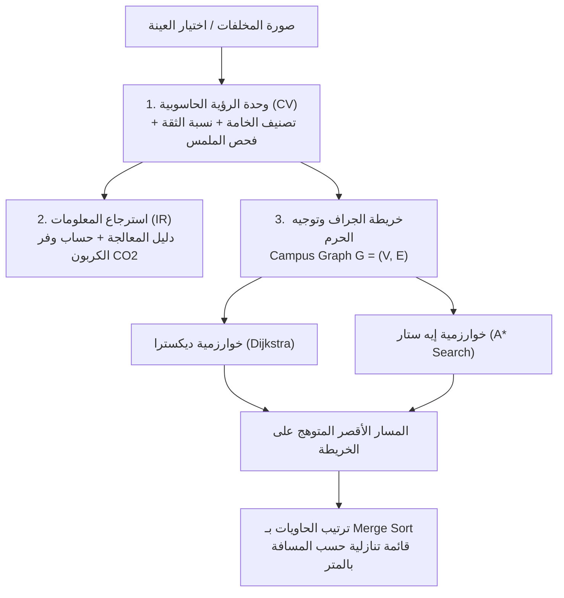

# 🌱 EcoSort - نظام الفرز والتوجيه الذكي بجامعة كفر الشيخ
### Kafrelsheikh University Smart Waste Sorting & Campus Routing System
> **مشروع أكاديمي تطبيقي يدمج بين ثلاثة مجالات حاسوبية رئيسية في شاشة تفاعلية واحدة:**
> 1. **الرؤية الحاسوبية (Computer Vision - CV)**
> 2. **استرجاع المعلومات والبحث الذكي (Information Retrieval - IR)**
> 3. **نظرية المخططات وهندسة الخوارزميات (Graph Theory & Algorithms)**

---

## 🌟 نظرة عامة على المشروع (Project Overview)

مشروع **EcoSort** هو تطبيق ويب أحادي الصفحة (**Single Page Web App - SPA**) باللغة العربية (RTL) مصمم كنموذج رائد لجامعة كفر الشيخ ("الجامعة الخضراء"). يتبع التطبيق معمارية **الخطوات المتسلسلة (Step-by-Step Wizard Flow)** مع شريط تقدم علوي تفاعلي (Progress Stepper) يقسم تجربة المستخدم إلى 3 مراحل واضحة تختفي فيها كل شاشة بسلاسة عند الانتقال للمرحلة التالية:
1. **الخطوة 1: تحديد موقع المستخدم الحالي** (بطاقات كليات تفاعلية + محاكاة GPS الذكية).
2. **الخطوة 2: فحص المخلفات ودليل المعالجة والأثر البيئي** (الرؤية الحاسوبية CV & الاختيار السريع & استرجاع المعلومات IR).
3. **الخطوة 3: الخريطة التفاعلية وأقصر مسار وتقييم الخوارزميات** (Dijkstra & A* & Merge Sort & محاكاة السير).

---

## 📐 المجالات الأكاديمية الثلاثة المدمجة (Integrated Academic Pillars)



### 1. الرؤية الحاسوبية (Computer Vision - CV):
- **التعرف والتصنيف البصري:** محاكاة استدلال شبكات عصبية التلافيفية عميقة (`MobileNetV3-WasteClassifier` / `TensorFlowJS`).
- **عينات الاختبار السريعة:** زجاجة بلاستيك PET، عبوة منظف HDPE، علبة كانز معدن ألومنيوم، كرتون وأوراق، بقايا طعام عضوية، ونفايات إلكترونية.
- **رفع صور حقيقية:** يدعم السحب والإفلات (Drag & Drop) وفحص هيستوجرام الألوان والسطوع والتباين عبر `HTML5 Canvas API`.
- **مخرجات التحليل:** نوع الخامة، رمز التدوير (`1-PETE`, `2-HDPE`, `41-ALU`, `20-PAP`)، نسبة الثقة (Confidence %)، وصف الملمس، والخصائص البصرية، وزمن الاستدلال بالميللي ثانية.

### 2. استرجاع المعلومات (Information Retrieval - IR):
- **معالجة اللغة الطبيعية العربية (Arabic NLP):**
  - إزالة التشكيل (Tashkeel Stripping).
  - توحيد الألفات والهمزات والتاء المربوطة (`أ, إ, آ -> ا` و `ة -> ه` و `ى -> ي`).
  - تصفية الكلمات الزائدة (Stop Words Filtering).
- **التشابه الضبابي (Fuzzy Matching):** حساب مسافة ليفنشتاين (`Levenshtein Distance`) لتجاوز الأخطاء الإملائية الشائعة لدى المستخدمين.
- **دليل المعالجة والأثر البيئي:** يظهر فورياً بمجرد التعرف على الخامة، ويعرض خطوات التجهيز الصحيحة، وحساب التوفير في انبعاثات الكربون بالجرام (CO₂ Savings in grams)، وتوفير المياه والطاقة.

### 3. نظرية المخططات والخوارزميات (Graph Theory & Algorithms):
- **تمثيل حرم جامعة كفر الشيخ:** رسم بياني موزون ثنائي الاتجاه $G = (V, E)$ يحتوي على 12 كلية ومبنى رئيسياً و 25 ممراً ومسار مشاة حقيقي بالمسافات بالمتر.
- **خوارزمية ديكسترا (Dijkstra's Algorithm):**
  - إيجاد أقصر مسار للمشاة من موقع الطالب الحالي إلى أقرب حاوية تقبل الخامة وتكون "متاحة (Available)".
  - التعقيد الحسابي: $O((V + E) \log V)$، مساحة $O(V)$.
- **خوارزمية إيه ستار (A* Search Algorithm):**
  - بحث استرشادي موجه يستخدم الدالة $f(n) = g(n) + h(n)$.
  - دالة التقدير الإرشادي المقبولة إقليدياً (Admissible Euclidean Heuristic): $h(n) \le h^*(n)$ لضمان الوصول للمسار الأمثل بنسبة 100% مع فحص عدد أقل من العقد مقارنة بانتشار ديكسترا الدائري.
- **خوارزمية الترتيب بالدمج (Merge Sort):**
  - تطبيق استراتيجية "فرّق تسُد" (Divide & Conquer) لترتيب كافة الحاويات المتاحة في الحرم الجامعي ترتيباً تصاعدياً حسب مسافة المشي الحقيقية.
  - التعقيد الحسابي: $O(n \log n)$ في كافة الحالات مع ثبات الاستقرار (Stable Sort).

---

## 🏛️ كليات ومعالم خريطة حرم جامعة كفر الشيخ

| العقدة (Node ID) | اسم المنشأة / الكلية | نوع الحاويات المتوفرة |
| :--- | :--- | :--- |
| `gate` | **البوابة الرئيسية (طريق الجيش)** | بلاستيك، معادن، أوراق |
| `ai` | **كلية الذكاء الاصطناعي** | بلاستيك، معادن، أوراق، نفايات إلكترونية |
| `eng` | **كلية الهندسة** | بلاستيك، معادن وكانز، أوراق، نفايات إلكترونية |
| `fci` | **كلية الحاسبات والمعلومات** | معادن وكانز، أوراق، تقنيات (بلاستيك ممتلئ) |
| `sci` | **كلية العلوم** | بلاستيك، معادن، زجاج معملي |
| `restaurant` | **المطعم المركزي والخدمات** | بلاستيك، معادن، كرتون، مخلفات عضوية (كومبوست) |
| `pharmacy` | **كلية الصيدلة** | معادن، كرتون، زجاج دوائي |
| `medicine` | **كلية الطب والمستشفى الجامعي** | بلاستيك، معادن، أوراق |
| `library` | **المكتبة المركزية والمؤتمرات** | بلاستيك، معادن، أوراق وكتب |
| `admin` | **مبنى إدارة الجامعة ورئاستها** | بلاستيك، أوراق |
| `sports` | **المجمع الرياضي والصالة المغطاة** | بلاستيك مياه، كانزات طاقة، أوراق |
| `agri` | **كلية الزراعة والحدائق** | بلاستيك، معادن، أوراق، تسميد عضوي |

---

## 📂 الهيكل البرمجي للمشروع (Project Structure)

```text
EcoSort/
├── index.html                  # واجهة التطبيق الرئيسية (Single Page Dashboard)
├── README.md                   # التوثيق الأكاديمي والتقني الشامل
├── css/
│   ├── style.css               # المتغيرات اللونية، خط Cairo، والتخطيط المتجاوب RTL
│   └── components.css          # تصميم البطاقات، الحاويات، الكانفاس، وجدول المقارنة
├── js/
│   ├── app.js                  # المنسق الرئيسي وإدارة الحالة (Coordinator & State)
│   ├── data/
│   │   ├── campus-graph.js     # بيانات كليات جامعة كفر الشيخ ومسافات الممرات كـ Graph
│   │   └── waste-database.js   # قاعدة بيانات الخامات، التدوير، والأثر الكربوني
│   ├── algorithms/
│   │   ├── dijkstra.js         # خوارزمية ديكسترا لأقصر مسار مع شروح أكاديمية مفصلة
│   │   ├── a-star.js           # خوارزمية إيه ستار مع الدالة الاسترشادية الإقليدية
│   │   └── merge-sort.js       # خوارزمية الترتيب بالدمج (Divide & Conquer)
│   └── modules/
│       ├── vision-module.js    # وحدة الرؤية الحاسوبية والاستدلال وتحليل الملمس
│       ├── search-ir.js        # محرك البحث الذكي واسترجاع المعلومات العربي
│       ├── graph-canvas.js     # عارض الخريطة التفاعلي بـ HTML5 Canvas مع حركة المسار
│       └── evaluation-ui.js    # لوحة تقييم الأداء والمقارنة الأكاديمية
└── tests/
    └── test-verification.js    # اختبارات التحقق الآلية لجميع الخوارزميات
```

---

## 🚀 طريقة تشغيل المشروع (How to Run)

المشروع مصمم وفقاً لأعلى معايير الويب الصرف (**Vanilla HTML5, CSS3, JavaScript**):
1. **التشغيل المباشر:** ما عليك سوى فتح ملف `index.html` في أي متصفح حديث (Chrome, Edge, Firefox, Safari) بالنقر المزدوج عليه. لا حاجة لأي إعدادات معقدة أو اتصال إنترنت!
2. **التشغيل عبر خادم محلي (اختياري):**
   ```bash
   # باستخدام بايثون
   python -m http.server 8000
   
   # أو باستخدام Node.js
   npx serve .
   ```
   ثم فتح الرابط `http://localhost:8000`.

3. **تشغيل الاختبارات الآلية الأكاديمية:**
   ```bash
   node tests/test-verification.js
   ```

---

## 🧪 ميزات تفاعلية مميزة للمناقشة ولجنة التحكيم (Viva Highlights)

1. **إعادة التوجيه اللحظي عند امتلاء الحاوية (Dynamic Rerouting):**
   - انقر على أي كلية على الخريطة لفتح نافذة فحص حاوياتها.
   - حوّل حالة أي حاوية من **متاحة 🟢** إلى **ممتلئة 🔴**.
   - ستشاهد فورياً كيف تقوم الخوارزمية (Dijkstra / A*) بإعادة التوجيه اللحظي نحو أقرب كلية بديلة متخطية الحاوية الممتلئة!
2. **محاكاة مسار حركة الطالب (Walk Traversal Simulation):**
   - اضغط على زر **"محاكاة السير"** لمشاهدة مجسم الطالب يتحرك بانسيابية عبر المسار الأقصر نحو الحاوية.
3. **المقارنة الأكاديمية المباشرة (Side-by-Side Comparison):**
   - التبديل بين `Dijkstra` و `A*` لملاحظة زمن التنفيذ بالـ `ms`، وعدد العقد المستكشفة، وكيف يُقلل A* عدد العقد المفحوصة بفضل التوجيه الاسترشادي.
4. **البحث الذكي المقاوم للأخطاء الإملائية (IR Typo Tolerance):**
   - جرب كتابة كلمة بها خطأ مثل "بلستك" أو "كنز" في شريط البحث العلوي، وشاهد قدرة خوارزمية Levenshtein على استرجاع الخامة الصحيحة فوراً.

---

## 🎓 إشراف وبيانات المشروع
- **المشروع:** نظام الفرز والتوجيه الذكي للمخلفات (EcoSort).
- **الجهة:** جامعة كفر الشيخ - قسم علوم الحاسب والذكاء الاصطناعي.
- **العام الأكاديمي:** 2026.
