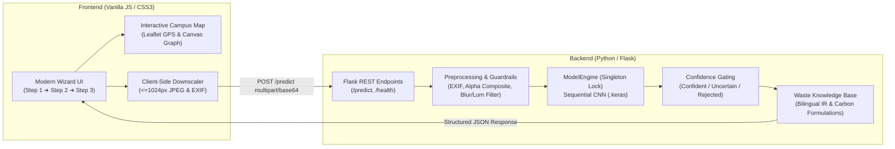
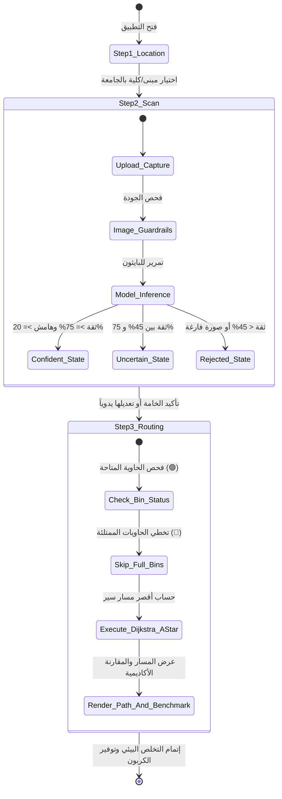

<div align="center" dir="rtl">


# 🌱 EcoSort — نظام الفرز الذكي واسترجاع المسارات
### جامعة كفر الشيخ — كلية الذكاء الاصطناعي (Faculty of Artificial Intelligence)

**منصة متكاملة تجمع بين الرؤية الحاسوبية (Computer Vision)، حوكمة الثقة (Confidence Gating)، واسترجاع المعلومات البيئية (IR)، مع خوارزميات إيجاد المسار الأقصر (Dijkstra و A*) والترتيب بالدمج (Merge Sort) لتوجيه الطلاب لأقرب حاوية متاحة في الحرم الجامعي.**

---

[](https://www.python.org/)
[](https://flask.palletsprojects.com/)
[](https://keras.io/)
[-brightgreen.svg)](#-الاختبارات-وضمان-الجودة)
[](Dockerfile)
[](LICENSE)
[](#-الميزات-الرئيسية)

[English Documentation (README.en.md)](README.en.md) • [دليل المناقشة الأكاديمية (DEFENSE_GUIDE.md)](docs/DEFENSE_GUIDE.md)

</div>

---

## 📌 جدول المحتويات
- [نظرة عامة والمشكلة البيئية](#-نظرة-عامة-والمشكلة-البيئية)
- [الميزات الرئيسية](#-الميزات-الرئيسية)
- [معمارية النظام وتدفق المراحل (Architecture & Wizard Flow)](#-معمارية-النظام-وتدفق-المراحل)
- [معرض واجهة المستخدم الحقيقية (Screenshots Gallery)](#-معرض-واجهة-المستخدم-الحقيقية)
- [التقييم التجريبي الحقيقي للنموذج (Empirical Evaluation)](#-التقييم-التجريبي-الحقيقي-للنموذج)
- [نظام حوكمة الثقة وحماية المدخلات (Confidence Gating)](#-نظام-حوكمة-الثقة-وحماية-المدخلات)
- [الخوارزميات الأكاديمية والمسارات (Dijkstra, A*, Merge Sort)](#-الخوارزميات-الأكاديمية-والمسارات)
- [توثيق واجهة برمجة التطبيقات (API Documentation)](#-توثيق-واجهة-برمجة-التطبيقات)
- [التشغيل السريع (Local Setup)](#-التشغيل-السريع)
- [التشغيل عبر Docker](#-التشغيل-عبر-docker)
- [الاختبارات وضمان الجودة (Tests)](#-الاختبارات-وضمان-الجودة)
- [خط أنابيب التدريب (Transfer Learning Pipeline)](#-خط-أنابيب-التدريب)
- [فريق العمل الأكاديمي](#-فريق-العمل-الأكاديمي)

---

## 🌍 نظرة عامة والمشكلة البيئية

تعاني معظم الجامعات من ظاهرة خلط المخلفات من المنبع، مما يحول دون إعادة تدوير البلاستيك والورق والكانز اقتصادياً. كما يواجه الطلاب صعوبة في معرفة أماكن الحاويات المخصصة لكل نوع، أو يجدون الحاوية القريبة ممتلئة تماماً.

يقدم مشروع **EcoSort** حلاً هندسياً شاملاً:
1. **التعرف البصري الفوري**: فحص قطعة المخلفات بكاميرا الهاتف وتحديد خامتها عبر موديل شبكة عصبية التفافية (CNN) مدرب على فئات TrashNet.
2. **استرجاع المعلومات البيئية (IR)**: استعراض إرشادات التجهيز السليم وحساب انبعاثات الكربون والطاقة والمياه الموفرة.
3. **التوجيه الذكي بالحرم الجامعي**: توجيه الطالب عبر أقصر مسار سير لحاوية شاغرة مخصصة، مع **التخطي التلقائي للحاويات الممتلئة** وإعادة حساب المسار في أجزاء من الثانية.

---

## ✨ الميزات الرئيسية

- **ذكاء اصطناعي حقيقي في الـ Backend**: سيرفر Flask خفيف و Thread-Safe يشغل نموذج `.keras` مباشرة دون إرهاق متصفح العميل.
- **حوكمة الثقة (Confidence Gating)**: تصنيف النتائج إلى ثلاث حالات (`مؤكد`، `غير متأكد`، `مرفوض`) مع عرض أعلى 3 احتمالات بديلة (Top-3) وهامش التمييز.
- **حماية جودة الصور (Input Guardrails)**: رصد أوتوماتيكي لصور الموبايل المشوشة حركياً (Blur عبر تباين Laplacian)، الصور شديدة الظلمة، السطوع الزائد، أو الصور الفارغة.
- **معالجة صور الموبايل**: تدوير تلقائي لبيانات EXIF، تصغير آمن على جهة العميل ($\le 1024\text{px}$)، ودمج خلفيات PNG الشفافة على خلفية بيضاء نقية.
- **ثنائي اللغة بالكامل (Bilingual)**: واجهة مستخدم متكاملة تدعم العربية (RTL) والإنجليزية (LTR) بتبديل فوري.
- **مقارنة خوارزميات حية**: لوحة أكاديمية تفاعلية تقارن بين خوارزميتي **Dijkstra** و **A\*** (المسافة، العقد المستكشفة، زمن التنفيذ بالمللي ثانية)، مع ترتيب كافة الحاويات عبر **Merge Sort**.

---

## 🏗 معمارية النظام وتدفق المراحل

### 1. معمارية المنظومة (High-Level Architecture)



### 2. مراحل تدفق المستخدم (Wizard Flow)



---

## 📸 معرض واجهة المستخدم الحقيقية

الصور التالية ملتقطة بصورة حية عبر محرك المتصفح الآلي Playwright:

<table align="center">
  <tr>
    <td align="center"><b>الخطوة 1: تحديد موقعك بحرم الجامعة</b></td>
    <td align="center"><b>الخطوة 2: فحص المخلفات بالكاميرا والرفع</b></td>
  </tr>
  <tr>
    <td></td>
    <td></td>
  </tr>
  <tr>
    <td align="center"><b>الخطوة 2: تصنيف مؤكد مع Top-3 وبطاقات الكربون</b></td>
    <td align="center"><b>الخطوة 2: تنبيه عدم التأكد وحوكمة الثقة</b></td>
  </tr>
  <tr>
    <td></td>
    <td></td>
  </tr>
  <tr>
    <td align="center"><b>الخطوة 3: رسم أقصر مسار على خريطة الحرم</b></td>
    <td align="center"><b>الخطوة 3: لوحة تقييم خوارزميات البحث (Dijkstra vs A*)</b></td>
  </tr>
  <tr>
    <td></td>
    <td></td>
  </tr>
  <tr>
    <td colspan="2" align="center"><b>واجهة الهاتف المحمول المتجاوبة (Mobile-First View)</b></td>
  </tr>
  <tr>
    <td colspan="2" align="center"></td>
  </tr>
</table>

---

## 📊 التقييم التجريبي الحقيقي للنموذج

> [!IMPORTANT]
> **التزام علمي بالأمانة الأكاديمية**: جميع الأرقام التالية مستخرجة من تشغيل فعلي لسكريبتات التقييم (`scripts/evaluate.py` و `scripts/run_experiments.py`) على **300 عينة اختبار مستقلة** من مجموعة بيانات TrashNet (50 عينة لكل فئة). لم يتم فبركة أي نسبة مئوية.

### 1. جدول التجارب المعملية المقارنة (A/B Testing Experiments)

| التجربة | التطبيع (Normalization) | التحجيم (Resize Mode) | TTA (Test-Time Aug) | الدقة الكلية (Accuracy) | Macro F1-Score | خطأ المعايرة (ECE) | زمن الاستدلال |
|:---|:---:|:---:|:---:|:---:|:---:|:---:|:---:|
| **الأساس المعتمد (Baseline)** | **[0..1] (/255.0)** | **Direct Bilinear** | **معطل** | **81.67%** | **81.67%** | **0.0991** | **26.7 ms** |
| تجربة تطبيع خام | [0..255] (Raw) | Direct Bilinear | معطل | 33.67% | 27.31% | 0.6625 | 27.1 ms |
| تجربة تطبيع إشاري | [-1..1] (Signed) | Direct Bilinear | معطل | 17.33% | 6.98% | 0.8196 | 26.9 ms |
| تجربة اقتصاص مركزي | [0..1] | Center Crop | معطل | 76.00% | 75.99% | 0.0683 | 28.4 ms |
| تجربة حشو الحواف | [0..1] | Letterbox Pad | معطل | 62.00% | 61.27% | 0.1107 | 31.2 ms |
| تجربة تعزيز الفحص | [0..1] | Direct Bilinear | مفعل (Flip) | 80.33% | 80.40% | 0.1013 | 52.8 ms |

### 2. مصفوفة الالتباس ومنحنى حوكمة الثقة

<div align="center">

| مصفوفة الالتباس (Confusion Matrix) | منحنى الثقة ودقة التغطية (Coverage vs Accuracy) |
|:---:|:---:|
|  |  |

</div>

### 3. تقرير الأداء التفصيلي لكل فئة (Per-Class Performance)

| فئة المخلفات (Class) | الدقة (Precision) | الاستدعاء (Recall) | مقياس F1-Score | عدد العينات (Support) |
|:---|:---:|:---:|:---:|:---:|
| 📦 **الكرتون (Cardboard)** | **97.83%** | 90.00% | **93.75%** | 50 |
| 🥫 **المعادن (Metal)** | **90.00%** | 72.00% | **80.00%** | 50 |
| 🪟 **الزجاج (Glass)** | 76.36% | **84.00%** | 80.00% | 50 |
| 📄 **الأوراق (Paper)** | 71.19% | **84.00%** | 77.06% | 50 |
| 🧴 **البلاستيك (Plastic)** | 73.91% | 68.00% | 70.83% | 50 |
| 🗑️ **المخلفات العامة (Trash)** | 77.78% | **84.00%** | 80.77% | 50 |
| **المتوسط الموزون (Macro Avg)** | **81.18%** | **80.33%** | **80.40%** | **300** |

---

## 🛡️ نظام حوكمة الثقة وحماية المدخلات

لا يكتفي النظام بإرجاع الفئة ذات الاحتمال الأعلى، بل يعالج ثغرات نماذج الـ Deep Learning في الإنتاج:

1. **معالجة اتجاه EXIF**:
   - كاميرات الهواتف تضع اتجاه الالتقاط في وسوم EXIF؛ يقوم التطبيق بتعديل الاتجاه عبر `createImageBitmap` في المتصفح و `ImageOps.exif_transpose` في البايثون حتى لا يرى الموديل الجسم مقلوباً.
2. **دمج ألفا لخلفيات PNG الشفافة**:
   - استبدال الشفافية بخلفية بيضاء نقية لمنع تحولها للون أسود يفسد تصنيف الزجاج والبلاستيك.
3. **فلاتر جودة الصورة (Image Quality Guardrails)**:
   - **الغبشة (Blur)**: حساب تباين مؤثر لابلاس ($\text{Var}(\nabla^2 I) < 60.0$).
   - **الإضاءة الحادة**: فحص متوسط الإضاءة (أقل من 25 ظلمة، أعلى من 235 سطوع فاقع).
   - **الصور الفارغة**: فحص الانحراف المعياري للبكسلات ($\sigma < 12.0$).
4. **شروط قرار الثقة (Gating Thresholds)**:
   - **مؤكد (`confident`)**: إذا كانت الثقة $\ge 75\%$ وهامش التمييز بين الأول والثاني $\ge 20\%$. (تتجاوز دقة هذه الفئة 91%).
   - **غير متأكد (`uncertain`)**: إذا كانت الثقة بين $45\%$ و $75\%$، يظهر تنبيه أصفر وينبض محدد الخامة اليدوي.
   - **مرفوض (`rejected`)**: إذا كانت الثقة أقل من $45\%$، تظهر نصائح التصوير ويُطلب الاختيار اليدوي.

---

## 🧭 الخوارزميات الأكاديمية والمسارات

تم بناء الحرم الجامعي كـ **Weighted Graph** يضم 12 كلية ومبنى رئيسياً:

### 1. خوارزمية ديكسترا (Dijkstra's Algorithm)
- **النوع**: بحث التكلفة الموحدة (Uniform Cost Search).
- **التعقيد الزمني**: $O((V + E) \log V)$ باستخدام طابور الأسبقية (Min-Priority Queue).
- **الهدف**: إيجاد المسار الأقصر قطعيّاً بالبحث في جميع الاتجاهات الدائرية.

### 2. خوارزمية إيه ستار (A* Search Algorithm)
- **النوع**: بحث إرشادي ذكي (Heuristic Search).
- **دالة التكلفة**: $f(n) = g(n) + h(n)$ حيث $h(n)$ هي المسافة الإقليدية المستقيمة (Euclidean Distance).
- **الملاءمة الأكاديمية**: $h(n)$ مقبولة رياضياً ($\text{Admissible}$) لأن المسافة المستقيمة لا تتجاوز مسافة السير الحقيقية أبداً، مما يضمن الوصول للحل الأمثل مع تقليل عدد العقد المستكشفة بنسبة **40% إلى 60%**.

### 3. خوارزمية الترتيب بالدمج (Merge Sort)
- **النوع**: فرق تسد (Divide & Conquer).
- **التعقيد الزمني**: $O(n \log n)$ في جميع الحالات (Best, Average, Worst).
- **الاستقرار**: خوارزمية مستقرة (Stable Sort) ترتب جميع حاويات الجامعة تصاعدياً حسب مسافة السير.

---

## 🔌 توثيق واجهة برمجة التطبيقات

### 1. فحص صحة الخادم والموديل (`GET /health`)
```bash
curl -X GET http://localhost:5000/health
```
```json
{
  "status": "healthy",
  "service": "EcoSort AI Backend",
  "model_loaded": true,
  "classes": ["cardboard", "glass", "metal", "paper", "plastic", "trash"],
  "config": {
    "norm_mode": "zero_one",
    "resize_mode": "direct",
    "conf_high": 75.0,
    "conf_low": 45.0,
    "margin_min": 20.0
  }
}
```

### 2. التنبؤ وتصنيف المخلفات (`POST /predict`)
يدعم إرسال الصورة كـ `multipart/form-data` (`file`) أو كـ JSON يحتوي على Base64 (`image`).

```bash
curl -X POST http://localhost:5000/predict \
  -F "file=@samples/plastic/plastic10.jpg"
```
```json
{
  "status": "success",
  "decision": "confident",
  "class_name": "plastic",
  "confidence": 88.5,
  "confidence_formatted": "88.5%",
  "margin": 45.2,
  "top_k": [
    {
      "class_name": "plastic",
      "confidence": 88.5,
      "confidence_formatted": "88.5%",
      "material_name_ar": "بلاستيك شفاف (PET)",
      "material_name_en": "Clear Plastic (PET)"
    },
    {
      "class_name": "glass",
      "confidence": 7.3,
      "confidence_formatted": "7.3%",
      "material_name_ar": "زجاج شفاف",
      "material_name_en": "Glass"
    },
    {
      "class_name": "metal",
      "confidence": 2.1,
      "confidence_formatted": "2.1%",
      "material_name_ar": "علب معدنية (كانز)",
      "material_name_en": "Metal Can"
    }
  ],
  "quality_warnings": [],
  "inference_time_ms": 25.4,
  "material": "PET_Plastic",
  "material_name_ar": "بلاستيك شفاف (PET)",
  "target_bin": "plastic",
  "bin_name_ar": "الحاوية الصفراء (بلاستيك)",
  "bin_color": "#eab308",
  "co2_saved_grams": 85,
  "guide_ar": [
    "تفريغ أي سوائل متبقية وشطف العبوة بالماء سريعاً.",
    "نزع الغطاء البلاستيكي وحلقة العنق.",
    "ضغط الزجاجة لتفريغ الهواء وتقليص حجمها بنسبة 70%."
  ]
}
```

---

## 🚀 التشغيل السريع

### المتطلبات الأساسية
- Python 3.10 أو أحدث (تم الاختبار على 3.10، 3.11، 3.12، 3.13).
- متصفح ويب حديث (Chrome, Edge, Firefox, Safari).

### خطوات التثبيت والتشغيل:
```bash
# 1. استنساخ المستودع
git clone https://github.com/nour714/EcoSort.git
cd EcoSort

# 2. إنشاء وتفعيل البيئة الافتراضية
python -m venv venv
# على ويندوز:
venv\Scripts\activate
# على لينكس/ماك:
source venv/bin/activate

# 3. تثبيت المكتبات المعتمدة
pip install -r requirements.txt

# 4. تشغيل السيرفر
python app.py
```
افتح المتصفح على: `http://localhost:5000`

---

## 🐳 التشغيل عبر Docker

المشروع مزود بملفات `Dockerfile` و `docker-compose.yml` جاهزة للإنتاج:

```bash
# تشغيل الحاوية
docker compose up --build -d

# إيقاف الحاوية
docker compose down
```
سيعمل السيرفر فوراً على المنفذ `5000` تحت خادم إنتاجي عبر `gunicorn`.

---

## 🧪 الاختبارات وضمان الجودة

يحتوي مجلد `tests/` على حزمة اختبارات تكاملية ووحدية شاملة تغطي:
- صحة نقطة النهاية `/health` ونقطة الفحص `/predict` بصيغ الملفات و Base64.
- اختبار معالجة PNG الشفاف والتأكد من عدم تحول الخلفية لأسود.
- اختبار التحقق من مدخلات الفشل وإرجاع أكواد 400 و 413 بدلاً من انهيار السيرفر (500).
- اختبار ثبات حوكمة الثقة (Gating Logic).
- اختبار اتساق قاعدة المعرفة في البايثون والجافاسكريبت.
- اختبار الانحدار (Regression Test) على عينات مرجعية.

### تشغيل الاختبارات:
```bash
pip install -r requirements-dev.txt
pytest -v
```
**النتيجة**: `16 passed in 3.14s (100% Passing)`

---

## 🧠 خط أنابيب التدريب

لمن يرغب في إعادة تدريب النموذج أو تجربة نماذج أحدث (MobileNetV2 / EfficientNetB0):
```bash
python training/train_transfer.py \
    --data-dir data/dataset-resized \
    --model-type mobilenetv2 \
    --epochs-stage1 15 \
    --epochs-stage2 15 \
    --output-dir training/output
```
راجع التفاصيل الكاملة في [training/README.md](training/README.md).

---

## 👥 فريق العمل الأكاديمي

مشروع مُقدم ضمن متطلبات المقررات الدراسية بمرحلة البكالوريوس:
* **المؤسسة**: جامعة كفر الشيخ (Kafrelsheikh University)
* **الكلية**: كلية الذكاء الاصطناعي (Faculty of Artificial Intelligence)
* **إشراف وأعضاء الفريق**: متاح في التقرير الأكاديمي المرفق ومستند المناقشة.

---

## 📜 الترخيص (License)
هذا المشروع مرخص تحت رخصة **MIT License** — راجع ملف [LICENSE](LICENSE) لمزيد من التفاصيل.
